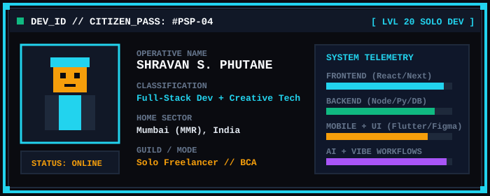

<pre>
╔═══════════════════════════════════════════════════════════════════════════╗
║  SYSTEM BOOT // PSHRAVAN04.EXE                           [█████ 100%]     ║
╚═══════════════════════════════════════════════════════════════════════════╝
</pre>

  

---

### `01 // THE REPOSITORY SOLAR SYSTEM`

  

 

| Celestial Body | Orbit | Repository / System | Stack | Telemetry Link |
| :--- | :--- | :--- | :--- | :--- |
| **SUN (Core)** | `0.0 AU` | **Pshravan04** — Central Hub & Workflows | Full-Stack | [ENTER CORE](https://github.com/Pshravan04) |
| **Planet 01** | `1.2 AU` | **LatticeSkill** — Real-time domain-matched anonymous chat | Next.js / WebSockets | [WARP TO REPO](https://github.com/Pshravan04/LatticeSkill) |
| **Planet 02** | `2.1 AU` | **OnlineSevak** — Geo-spatial civic issue reporting app | Flutter / Supabase | [WARP TO REPO](https://github.com/Pshravan04/OnlineSevak) |
| **Planet 03** | `3.4 AU` | **PropTech & CRM Suite** — High-conversion portals & CRMs | React / Node / PHP | [WARP TO REPO](https://github.com/Pshravan04?tab=repositories) |
| **Planet 04** | `4.8 AU` | **AI & Vibe Lab** — Local AI agents & rapid full-stack builds | Python / Next.js | [WARP TO REPO](https://github.com/Pshravan04?tab=repositories) |

---

### `02 // EQUIPPED INVENTORY (TECH STACK)`

  
  
  
  
  
  
  
  
  
  
  
  
  
  
  
  

---

### `03 // GITHUB MISSION LOGS`

  
  

